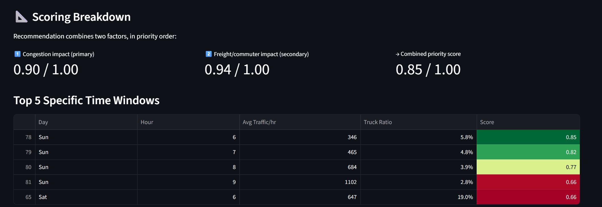

# 🚧 A3 Roadwork Scheduler

A data-driven tool that recommends the best time to schedule highway
construction on the A3 (Germany), using real historical traffic data,
a Prophet seasonal forecast with confidence intervals, and a LightGBM
model used to sanity-check that forecast in a backtest.

Built during the ConStructAI Hackathon @ THWS (June 2026), then cleaned up
and extended into the version in this repository.



> **Note on screenshots:** the images in this README predate the segment
> map, objective selector, and custom theme described below (see
> [Recent changes](#recent-changes)). Regenerate them locally with
> `streamlit run app.py` once you have real data in place — the layout
> and map have both changed since these were taken.

---

## Table of contents

- [What it does](#what-it-does)
- [Recent changes](#recent-changes)
- [Running it](#running-it)
- [Model accuracy (backtested)](#model-accuracy-backtested)
- [Methodology](#methodology)
- [Limitations](#limitations)
- [Project structure](#project-structure)
- [Background](#background)

---

## What it does

Pick a location, a direction, a construction duration, and your daily
working hours — the tool returns:

- A specific recommended calendar date range, backed by real traffic
  counts, not just an abstract "Sunday morning"
- A choice of **optimization objective** — least total traffic, least
  freight/truck impact, or a balanced default — so the recommendation
  matches what actually matters for your project
- An estimated CO2 impact of scheduling at the recommended time vs. the
  worst time
- For projects longer than 6 weeks, a **seasonal alternative** start
  month from a per-station Prophet forecast, shown with its confidence
  interval, not just a point estimate
- A **map of the exact highway segment** being scheduled — the stretch
  between the selected station and its nearest neighbor, following the
  real road via OSRM routing where possible, with a direction indicator
  and distinct start/end markers
- A short-term weather outlook (next 15 days) for short-duration projects
- The full weekly traffic pattern as a heatmap

## Recent changes

The original hackathon version scored (weekday, hour) slots by traffic
and truck ratio, forecast seasonally with Prophet, and showed the whole
A3 network on one map. This pass added:

- **`evaluate_models.py`** — a proper backtest (hold-out by trailing
  months, per station) comparing a seasonal-naive baseline, Prophet, and
  a new LightGBM model, with MAE/MAPE reported per station and overall.
- **Selectable optimization objective** in the app — "least total
  traffic," "least freight/truck impact," or the original balanced
  default — built from the same underlying traffic/truck-ratio scores.
- **Prophet's confidence interval**, shown wherever the seasonal forecast
  appears (the seasonal tip text and a new forecast chart), not just the
  mean.
- **A focused segment map** — instead of the whole A3 network, the map
  now highlights the actual stretch being scheduled (selected station to
  its nearest neighbor), following the real road via OSRM when reachable,
  with distinct endpoint markers and a direction indicator. Other stations
  are still shown, faded, for context.
- **A custom Streamlit theme** and tidier card-based layout.
- **Type hints, docstrings, a pinned `requirements.txt`, and unit tests**
  on the data-parsing layer.

None of the original scoring or forecasting logic was rewritten — this
extends it. See [Methodology](#methodology) for what's unchanged.

---

## Running it

### Requirements

```
pip install -r requirements.txt
```

This pins every dependency, including `prophet`, `lightgbm`, and
`scikit-learn` — the last two are needed only for `evaluate_models.py`,
and `prophet` only for `refresh_forecasts.py`; neither is imported by
`app.py` itself. They're heavier installs (`prophet` especially, since it
pulls in a Stan toolchain), so budget a few extra minutes the first time.

### Setting up your data folders

BASt's download gives you a set of zipped CSVs, one per station, for a
chosen year. Here's how to turn that into what `data_utils.py` expects:

1. Go to the [BASt Stundenwerte page](https://open.bydata.de/datasets?locale=de&query=Autobahn+Z%C3%A4hlstellen+A3&page=1&limit=10)
   and download the hourly data for a year (e.g. 2019). It comes as a
   `.zip` file.
2. **Unzip it.** Inside, you'll find one CSV per station, named something
   like `zst9010_2019.csv`.
3. In your project folder, **create a new folder named exactly after the
   year**, e.g. `2019`.
4. **Move all the unzipped CSVs for that year into that folder.**
5. Repeat for any other year you want to include (e.g. download 2023,
   unzip, create a `2023` folder, move its CSVs in).
6. Download [`Jawe2022.csv`](https://www.bast.de/DE/Themen/Digitales/HF_1/Massnahmen/verkehrszaehlung/Daten/2022_1/Jawe2022.html?nn=414410)
   from the Jahresdaten page and place it directly in the project's root
   folder (not inside a year folder) — it's used once for station
   coordinates and direction labels, not per-year.

Once this is done, your folder should look like:

```
your-project-folder/
├── app.py
├── data_utils.py
├── refresh_forecasts.py
├── evaluate_models.py
├── requirements.txt
├── Jawe2022.csv            (station coordinates + metadata)
├── prophet_results.json    (precomputed seasonal forecasts)
├── 2019/                   (one folder per year of traffic data)
│   ├── zst9010_2019.csv
│   ├── zst9011_2019.csv
│   └── ...
└── 2023/
    ├── zst9010_2023.csv
    └── ...
```

`data_utils.py` automatically scans for any folder named with exactly 4
digits and loads whatever CSVs are inside — you don't need to tell it
which years exist anywhere in the code.

### Start the app

```
streamlit run app.py
```

### Run the model backtest

```
python evaluate_models.py
```

This backtests seasonal-naive, Prophet, and LightGBM against a hold-out
of your most recent data and writes `evaluation_results.json`. See
[Model accuracy](#model-accuracy-backtested) below for what to do with
the numbers, and the script's own docstring (`evaluate_models.py`) for
options like `--holdout-months` and `--stations`.

### Refresh the seasonal forecast

```
python refresh_forecasts.py
```

Regenerates `prophet_results.json`, now including each month's 80%
confidence interval alongside the mean. Run this whenever you add a new
year of data — see [Adding new yearly data](#adding-new-yearly-data)
below.

---

## Model accuracy (backtested)

`evaluate_models.py` backtests three approaches per station, holding out
the last few months of real data as a test set never seen during
training:

| Model | Mean MAE (veh/hr) | Mean MAPE | Notes |
|---|---|---|---|
| Seasonal-naive (weekday × hour average) | _run `evaluate_models.py`_ | _—_ | baseline — roughly what the app's own scoring already does |
| Prophet (yearly + weekly + holidays) | _—_ | _—_ | used for the seasonal recommendation |
| LightGBM (calendar + lag features) | _—_ | _—_ | see the lag-feature caveat in the script's docstring |

*Fill in this table with your own run's numbers — `python
evaluate_models.py` prints a summary and writes the full per-station
breakdown to `evaluation_results.json`.*

The point of this comparison isn't to replace Prophet in the app (it
already produces the confidence interval the seasonal tip needs) — it's
to check that Prophet is actually earning its complexity against a naive
baseline, and to see whether a model with recent-history features
(LightGBM) does meaningfully better on short-range accuracy. Read the
`evaluate_models.py` docstring for the exact hold-out setup and its one
important caveat (LightGBM's lag features use real historical values,
which is a slightly generous setup for a model that won't have that
recent data available months ahead in production).

---

## Methodology

### Data source

BASt publishes hourly traffic counts per station, per year. Each row
includes vehicle counts in both directions (`KFZ_R1`/`KFZ_R2`), truck
counts (`Lkw_R1`/`Lkw_R2`), the weekday, and the hour. Station coordinates
and direction labels come from a separate yearly file (`Jawe2022.csv`).

The full data-cleaning process — including a documented mistake-then-fix
on parsing the coordinate format — is in `analysis.ipynb`, and the fixed
version (`fix_utm` in `data_utils.py`) is covered by a unit test in
`tests/test_data_utils.py`.

### Scoring formula

Every (weekday, hour) combination is scored on three reusable 0–1 factors:

```
congestion_score      = 1 - (avg_traffic / max_traffic)
freight_ratio_score    = 1 - avg_truck_ratio        # truck share of traffic
freight_volume_score   = 1 - (avg_trucks / max_trucks)   # absolute truck volume
```

The **optimization objective** picked in the app decides how these
combine into `final_score`:

| Objective | `final_score` | Use when... |
|---|---|---|
| Balanced (default) | `congestion_score × freight_ratio_score` | you want the original behavior — a slot only scores well if both total traffic and truck share are favorable |
| Least total traffic | `congestion_score` | minimizing total vehicle disruption is the only priority |
| Least freight/truck impact | `freight_volume_score × congestion_score` | minimizing disruption to freight/logistics matters more than total vehicle count — ranks by absolute truck volume, not just its share |

The balanced default multiplies rather than averages its two factors — a
time slot only scores well if both are favorable. A low-traffic hour that
happens to be truck-heavy gets pulled down, not just slightly discounted.

### CO2 estimate

Scheduling roadworks during a high-traffic window is assumed to force
affected vehicles into a ~2km detour. At ~120g CO2/km for an average car,
that's **0.24 kg CO2 per affected vehicle** — a simplification, but
directionally meaningful for comparing best vs. worst scheduling choices.

### Seasonal forecasting (Prophet)

For projects longer than 6 weeks, the historical weekly pattern alone
isn't enough — seasonal effects matter more. Prophet is fit per station on
the full hourly time series (yearly + weekly seasonality, plus German
public holidays as a separate learned effect), forecasting a full year
ahead. The resulting monthly averages, **plus Prophet's 80% confidence
interval**, are precomputed and saved to `prophet_results.json`, rather
than run live in the app. The app shows this interval next to the
recommended month and in a small forecast chart, not just the mean.

### The roadwork segment map

The app highlights the stretch of highway between the selected station
and its geographically nearest A3 station (`nearest_station` in
`data_utils.py`), rather than the whole network. It tries OSRM's public
routing API for the actual road geometry; if that's unreachable (offline,
rate-limited, or blocked), it falls back to a straight line between the
two points. Other stations are still shown, faded and colored by relative
traffic level, so you can still spot a quieter alternative nearby.

---

## Limitations

- **Prophet coverage:** stations need enough historical data points for
  Prophet to fit reliably; the rest fall back to a network-wide generic
  seasonal estimate instead of a station-specific one (and that fallback
  has no confidence interval — it isn't a real forecast).
- **Holiday effect is a rough signal:** with only a couple of years of
  training data, each public holiday has just a couple of historical
  examples for Prophet to learn from. It picks up large, obvious effects
  (e.g. Christmas being much quieter) but isn't a precise estimate — this
  will improve as more years of data are added.
- **The confidence interval is 80%, not 95%** (Prophet's `interval_width`
  is set explicitly in `refresh_forecasts.py`) — a deliberate choice to
  keep the band informative without being so wide it stops being useful
  at a glance.
- **LightGBM's backtest is slightly generous to itself:** its lag
  features are computed from real historical traffic, including near the
  test window — a fair comparison for "given recent data, how good is the
  short-range fit" but not identical to the multi-month-ahead forecast
  the app actually needs. See `evaluate_models.py`'s docstring.
- **The segment map's "nearest neighbor" is a geographic simplification:**
  it picks the closest other A3 station by straight-line distance, not by
  matching the specific `Fernziel_Ri1`/`Fernziel_Ri2` direction label to a
  compass bearing (that would need geocoding each destination city, which
  isn't done here). For most stations this is exactly the physically
  relevant stretch; near sharp bends in the route it may not perfectly
  match the labeled direction — check the map visually before finalizing
  plans.
- **OSRM routing depends on a public demo server** (`router.project-osrm.org`)
  with no uptime or rate-limit guarantees. The map falls back to a
  straight line automatically when it's unreachable, so the segment is
  always shown, just not always road-accurate.
- **Short-project recommendations assume a recurring weekly pattern:**
  for projects of a few weeks, the tool finds the single best weekly
  slot and repeats it. It doesn't yet check whether traffic stays
  consistently low across the entire project duration, just that the
  underlying weekly pattern is historically reliable.
- **Weather is informational, not predictive:** the short-term weather
  outlook (Open-Meteo) only displays for projects starting within ~15
  days, since forecasts beyond that aren't reliable. It does not feed
  into the scoring or seasonal forecast.
- **Data coverage gaps:** not every station has usable files for every
  year, due to broken or missing download links on BASt's portal. Years
  with very few stations are flagged with a warning when loaded, but
  still included — exclusion is a manual choice (see
  [Adding new yearly data](#adding-new-yearly-data) below).

---

## Project structure

| File | Purpose |
|---|---|
| `app.py` | The Streamlit application |
| `data_utils.py` | Loads and cleans traffic + coordinate data, auto-detects year folders |
| `refresh_forecasts.py` | Standalone script to regenerate `prophet_results.json` (with confidence intervals) |
| `evaluate_models.py` | Backtests seasonal-naive vs. Prophet vs. LightGBM per station; writes `evaluation_results.json` |
| `analysis.ipynb` | Full exploratory analysis, with documented reasoning for every data decision |
| `tests/` | Unit tests for the data-parsing layer (`pytest`) |
| `.streamlit/config.toml` | Custom theme |
| `requirements.txt` | Pinned dependencies |
| `prophet_results.json` | Precomputed per-station seasonal forecasts |
| `Jawe2022.csv` | Station coordinates and metadata (not included in this repo — sourced from BASt) |

## Adding new yearly data

The historical scoring layer updates automatically, but the seasonal
(Prophet) forecast needs a manual refresh. These two layers are separate
on purpose — fitting Prophet across every station takes several minutes,
so it's a deliberate step rather than something the app does silently
every time it starts.

### 1. Historical scoring — automatic

Follow the same "Setting up your data folders" steps above for the new
year: download from BASt, unzip, create a folder named after the year,
move the CSVs in. `data_utils.py` automatically detects any folder with a
4-digit name containing CSVs and includes it — no code changes needed.

To exclude a year (for example, an anomalous year you don't want included),
simply don't keep that folder in the project directory. This is a deliberate
choice left to whoever manages the data, rather than something hardcoded.

### 2. Seasonal forecast — manual refresh

1. Add your new year folder (e.g. `2024/`) alongside the existing ones
2. Run:
   ```
   python refresh_forecasts.py
   ```
3. This regenerates `prophet_results.json`, automatically including
   whatever years are currently present, with confidence intervals
4. Restart the Streamlit app

The script includes German national public holidays (2019–2026) as a
factor Prophet can learn from separately. If you add data for years beyond
2026, extend the `GERMAN_HOLIDAYS` list at the top of `refresh_forecasts.py`.

### 3. Re-run the backtest

Once you've added a new year, `python evaluate_models.py` will use it
too — a longer history generally means a more informative hold-out.

---

## Background

This project was built for the "Data-Based Forecasting for Road Renovation
Scheduling" challenge at the ConStructAI Hackathon (THWS, June 2026): given
real traffic data, recommend the optimal timing for A3 highway roadworks to
minimize disruption.

### Where the data comes from

All traffic and station data comes from BASt (Bundesanstalt für
Straßenwesen), Germany's federal road authority:

- **Hourly traffic counts** (the `zst*.csv` files, one per station per
  year): [BASt — Stundenwerte](https://open.bydata.de/datasets?locale=de&query=Autobahn+Z%C3%A4hlstellen+A3&page=1&limit=10)
- **Station coordinates and metadata** (`Jawe2022.csv`): [BASt — Jahresdaten](https://www.bast.de/DE/Themen/Digitales/HF_1/Massnahmen/verkehrszaehlung/Daten/2022_1/Jawe2022.html?nn=414410)

Both are free to download, no account needed.
