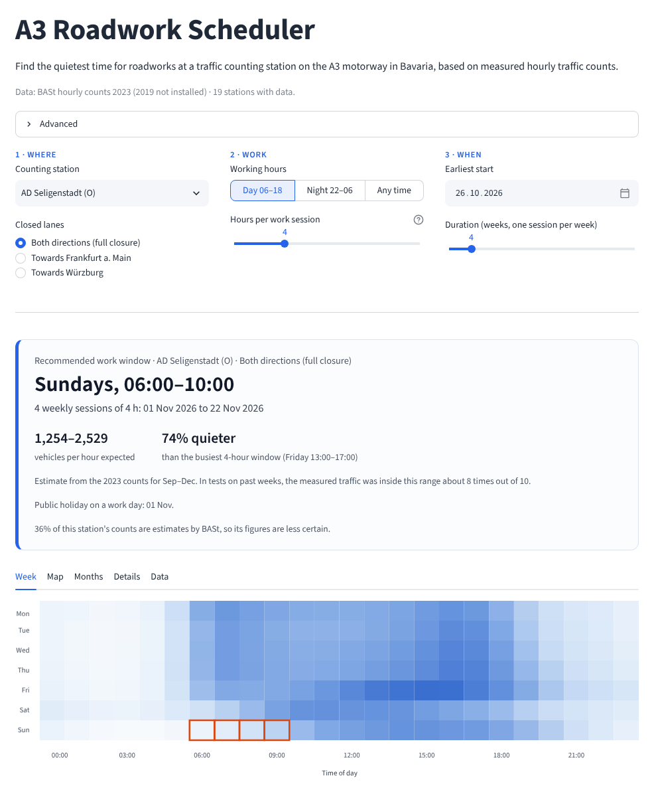

# A3 Roadwork Scheduler

Finds the quietest time for roadworks at a traffic counting station on the A3 motorway in Bavaria, from measured hourly traffic counts.



## Run it in 3 steps

You need Python 3.11 or newer (tested with 3.13) and git.

**1. Clone**

```
git clone -b feat/redesign https://github.com/mutallimof/a3-roadwork-scheduler.git
cd a3-roadwork-scheduler
```

**2. Install** (in a virtual environment)

Windows (PowerShell or cmd):
```
py -m venv .venv
.venv\Scripts\activate
pip install -r requirements.txt
```
macOS / Linux:
```
python3 -m venv .venv
source .venv/bin/activate
pip install -r requirements.txt
```

**3. Run**

```
streamlit run app.py
```

Your browser opens the app (otherwise go to http://localhost:8501). The data
comes with the repository, so nothing else needs to be downloaded.

These steps were run on a fresh clone on Linux with Python 3.13. The Windows
commands are the standard equivalents but were not run on Windows.

## What it does

- You pick a counting station, which lanes are closed, the working hours
  (day, night or any time), how long one work session lasts, the earliest
  start and the number of weeks.
- It shows the recommended weekly work window (for example "Sundays,
  06:00–10:00"), the session dates, the expected traffic as a range, and how
  much quieter the window is than the busiest one.
- Supporting views: the weekly traffic pattern with the window marked, a map
  of the stations, measured traffic in the window by month, the five best
  windows, and the data used.

## Data

**Source and licence.** Bundesanstalt für Straßenwesen (BASt), automatische
Dauerzählstellen, under the
[Datenlizenz Deutschland – Namensnennung – Version 2.0](https://www.govdata.de/dl-de/by-2-0).
The files were reorganised (unzipped, renamed, Bavarian A3 only) and the station
names in Jawe2023 were repaired; details in [DATA_LICENSE.md](DATA_LICENSE.md).
This project is not affiliated with or endorsed by BASt.

**What is included.** Hourly counts for 2018, 2022 and 2023 (`2018/`, `2022/`,
`2023/`, one file per station) and the station list `Jawe2023.csv` (46
stations on the A3 in Bavaria).

**Years used.** The app uses 2019 and 2023, as in the original analysis
(2020–2022 are left out because of COVID). 2019 is not included yet, so it
currently runs on 2023: 19 stations have counts. 2018 and 2022 are included
but not used. To use other years, set `A3_YEARS` before starting, for example
`set A3_YEARS=2018,2023` (Windows cmd) or `A3_YEARS=2018,2023 streamlit run app.py`
(macOS/Linux).

**Adding 2019.** Put the BASt 2019 files (zips or CSVs) into `raw_data/` and run
`python scripts/fetch_data.py`, or put files named `zst<station>_2019.csv`
into a folder `2019/`. The app picks them up on the next start.

**Rebuilding from the raw files.** `python scripts/fetch_data.py` unzips the
files in `raw_data/`, keeps the A3 rows, writes one file per station and year,
cleans the station list and checks every file. Run on the original downloads
it reproduces the included files exactly.

**Demo mode.** If no full data is present, the app uses the small extract in
`sample_data/` (3 stations, March–June 2023) and says so.

## How the recommendation works

1. Hours on public holidays and counts BASt marked as implausible are left out.
2. For each weekday and hour, the counts of all weeks are averaged.
3. Every block of consecutive hours inside the working hours is a candidate; it
   scores higher with less traffic and fewer trucks. The best block is the
   recommended window.
4. The expected traffic for that window is taken from the same months as the
   project, plus one month on either side, and shown as the range seen in tests.
5. Times are local clock times (BASt hour 1 = 00:00–01:00).

The code is in `scheduler.py`.

## Accuracy

Measured with `python scripts/backtest.py` on 7 weeks of July–December 2023,
19 stations, 665 recommendations. Only data from before each test week is used
to predict it.

| | Before: weekly average | Now: weekly average for the choice, seasonal estimate |
|---|---:|---:|
| Hourly error of the expected traffic (MAPE) | 21.0% | 17.6% |
| Hourly error (MAE, vehicles/hour) | 243 | 205 |
| Recommended window among the 3 quietest of its week | 85% | 85% |
| Extra traffic compared with the quietest window | 6.0% | 6.0% |
| Measured ÷ expected for the recommended window, 10th–90th percentile | 0.56–1.98 | 0.64–1.29 |

What this means:

- The choice of window is good: in 85% of tests it was one of the three
  quietest windows of that week, and on average it carried 6% more traffic
  than the very quietest one.
- The expected traffic is an estimate: off by about 18% per hour on average.
  For the recommended window the estimate tends to be too high (median
  measured ÷ expected 0.80), so the app shows a range (0.64× to 1.29× the
  estimate), which held in about 8 of 10 tests.
- Choosing the window on a seasonal profile was tested and made the choice
  worse (85% → 80%), so it is not used. All variants:
  [docs/backtest_profiles.md](docs/backtest_profiles.md); per case:
  [docs/backtest_after.md](docs/backtest_after.md).

## Limits

- **One year of data.** With 2019 missing, everything rests on 2023, and the
  tests predict weeks of 2023 from earlier weeks of 2023. Planning years ahead
  may be less accurate than the table shows.
- **Estimated counts.** For some stations up to 41% of the hourly counts are
  BASt estimates (shown in the app).
- **Holidays.** Only holidays valid in all of Bavaria are used; local ones
  such as 15 August are treated as normal days.
- **Station list.** 10 text values in `Jawe2023.csv` that the app does not use
  still contain `?` where a letter was lost in the source file.
- **Map.** The station map works offline and only roughly follows the road;
  the street map needs an internet connection.
- **CO2 figure** in the details is an illustration (2 km detour, 120 g CO2/km),
  not a measurement.

## Tests

```
python -m unittest discover -s tests
```

35 tests for the data loader, data checks, name repair, `scripts/fetch_data.py`
and the recommendation logic. They use small generated files, not real data.
Checks on the real data: `python scripts/backtest.py` (accuracy) and
`python scripts/data_report.py` (writes `data_report.md`: coverage and data
checks).

## Credits

- **Data:** Bundesanstalt für Straßenwesen (BASt), automatische
  Dauerzählstellen, hourly values 2018, 2022 and 2023 and the station list
  Jawe2023. Licence: Datenlizenz Deutschland – Namensnennung – Version 2.0,
  https://www.govdata.de/dl-de/by-2-0. Changes: [DATA_LICENSE.md](DATA_LICENSE.md).
- **aitraffic** ([github.com/DanieMyl/aitraffic](https://github.com/DanieMyl/aitraffic)),
  a joint project: the hourly files and Jawe2023 used here, and ideas adapted
  in this code: the BASt hour convention, scoring whole windows, shifts across
  midnight, leaving out implausible counts and public holidays, the quality-flag
  checks, the data report, the month view, and testing on held-out data. No
  code was copied unchanged. The comparison of both tools is in
  [docs/comparison.md](docs/comparison.md).
